# Banking Data Analysis

A project exploring a set of banking CSV tables, with a focus on understanding the data structure and analyzing **loan repayment behavior**.

## Project structure

```text
├── README.md
├── requirements.txt
├── .gitignore
├── notebooks/
│   ├── 01_inventory.ipynb            # Inventory + data quality + verified relationship mapping
│   ├── inventory_overview.ipynb      # Metadata-only/chunked scan (safer) + exports report
│   └── 02_loan_repayment.ipynb      # Loan repayment analysis (merge, metrics, outliers, trends)
├── reports/
│   ├── csv_inventory.csv             # Metadata summary (from inventory_overview.ipynb)
│   └── figures/                      # Saved visualizations (generated by notebooks)
└── data/
    ├── raw/                          # Local CSVs (gitignored; do not commit)
    └── processed/                    # Processed outputs (gitignored)
```

## Data placement (important)

Extract the supplied CSV files into `data/raw/` on your own computer. The raw/processed data folders are ignored by Git because the data includes sensitive customer and financial attributes. **Do not commit raw rows, processed extracts, or notebook outputs containing personal records.**

**Actual files used in `data/raw/`:** `accounts.csv`, `branches.csv`, `cards.csv`, `card_transactions.csv`, `customers.csv`, `employees.csv`, `loan_payments.csv`.

## What we’ve done (latest updates)

- **Inventory & profiling**: Built `inventory_overview.ipynb` for a chunked, metadata-only scan (row/column counts, inferred types, missing values) and saved `reports/csv_inventory.csv`. Updated its candidate links to match the actual schema.
- **Deeper exploration**: Used `01_inventory.ipynb` to inspect schemas/samples, run data quality checks, and **verify relationships** (exact overlaps, ID uniqueness, value overlap).
- **Loan repayment analysis (`02_loan_repayment.ipynb`)**:
  - Merged `loan_payments` → `accounts` → `customers`/`branches` using the verified key `loan_payments.loan_id` → `accounts.account_id`.
  - Checked merge quality and basic repayment metrics (late payment rate, amount summaries).
  - **Outlier detection & handling (Section 7, all in one place):** quick IQR checks (7A), enhanced distributions/boxplots and extreme-value review (7B), and recommended handling (7C) — **IQR flags** plus **p1–p99 capping (winsorizing)** for skewed monetary fields; `credit_score` kept as-is but flagged. Saves `data/processed/loans_full_processed.csv` (gitignored).
  - **Time-based trends (readable storytelling):** overall monthly trends, a **Jan–Dec year×month heatmap** for late rate (9A), and **pairwise Jan–Dec comparisons from 2010 onward** for both late payment rate and payment volume (9B), with figures saved to `reports/figures/`.
  - **February volume-drop investigation (Section 15):** compared Feb vs Jan/Mar using **payments per day** (controls for 28/29-day February), day-of-month (29–31) effects, and leap-year checks to explain what happened in February.
  - **Loan-level aggregation (`loan_level`, Section 10):** per-loan payments, totals/averages, late behavior, and “ever late”.
  - **Payment regularity & lateness severity (Section 16, loan-level):** severity buckets by % late, **max consecutive late run**, and payment-timing regularity (gap days) with sample-size-aware visuals.
  - **Drivers of late payments (Section 17, segment + controls):** late rates by `account_type`, location, occupation, and `credit_score`/income/balance bands using capped values where appropriate, with minimum sample thresholds, ~95% CIs, and a simple control view (account type within credit-score band). Differences indicate association, not causation.
  - **Deeper analysis:** late rate over time by `account_type`/state (readable small multiples + 3-month averages) and loan-level breakdowns with **sample-size checks**.
  - Added simple-English “Input/Output” and “Insight” notes throughout, and options to save processed outputs/figures to `data/processed/` and `reports/figures/`.

## Verified relationships (key joins)

Verified via relationship mapping in `01_inventory.ipynb`:
- `customers.customer_id` → `accounts.customer_id`, `cards.customer_id`
- `branches.branch_id` → `accounts.branch_id`, `employees.branch_id`
- `accounts.account_id` → `cards.account_id`
- `cards.card_id` → `card_transactions.card_id`
- `loan_payments.loan_id` → `accounts.account_id` *(loans/payments are linked through accounts in this dataset)*

> Always re-check key uniqueness and unmatched IDs before relying on joins for final conclusions.

## Visualizations & insights

The figures below are saved to `reports/figures/` when you run `notebooks/02_loan_repayment.ipynb`. If they don’t render yet, run the notebook top-to-bottom to generate them.

### 1) Monthly repayment trends
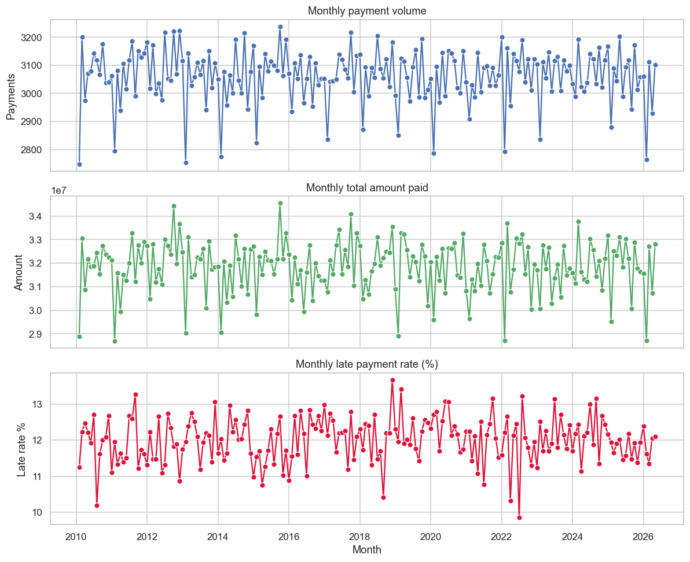

**Insight (simple terms):** These charts show how repayment activity changes month by month. Look for overall direction (up/down), sudden jumps, and whether the late payment rate is improving or getting worse over time. Use the volume chart alongside the late-rate chart—late rates can look unstable in low-volume periods.

### 2) Late payment rate over time by account type (readable view)
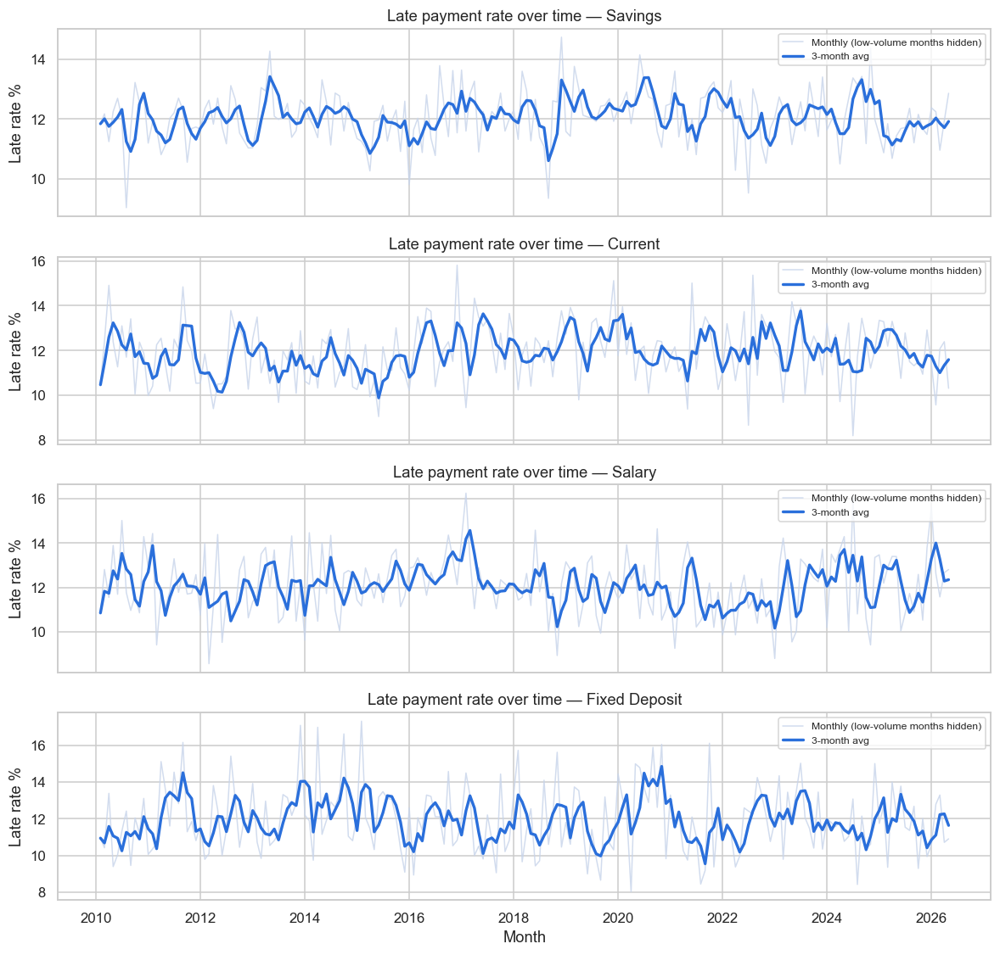

**Insight (simple terms):** Each panel tells the story for one account type. The **bold line** is a 3-month average (trend), and the faint line shows monthly movement. If one account type’s trend stays higher, that group tends to have more late payments. Check payment counts before making strong conclusions.

### 3) Late payment rate over time by state (readable view)


**Insight (simple terms):** This compares lateness trends across locations (top segments by volume). Persistent gaps between states may point to areas worth investigating, while noisy swings often reflect smaller monthly sample sizes.

### 4) Outlier distributions (review flags)
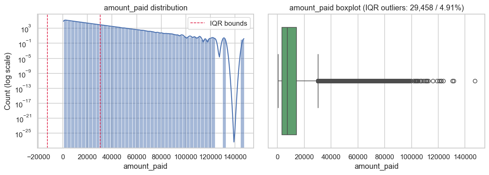

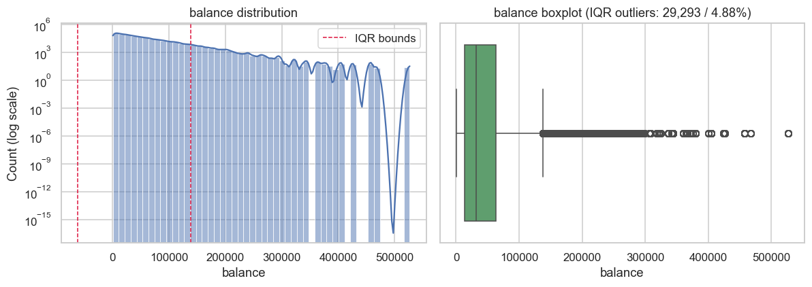

**Insight (simple terms):** Payment and balance fields often have a long “tail” (many typical values and a few very large ones). The dashed bounds and boxplot help flag unusual values, but **outliers aren’t automatically errors**—review extremes in context (e.g., large legitimate payments) before capping or removing. Outlier handling (Section 7C) also produces `data/processed/loans_full_processed.csv` locally (gitignored) with IQR flags and p1–p99 capped monetary columns for more stable analysis.

### 5) Late payment rate by year and month (Jan–Dec heatmap)
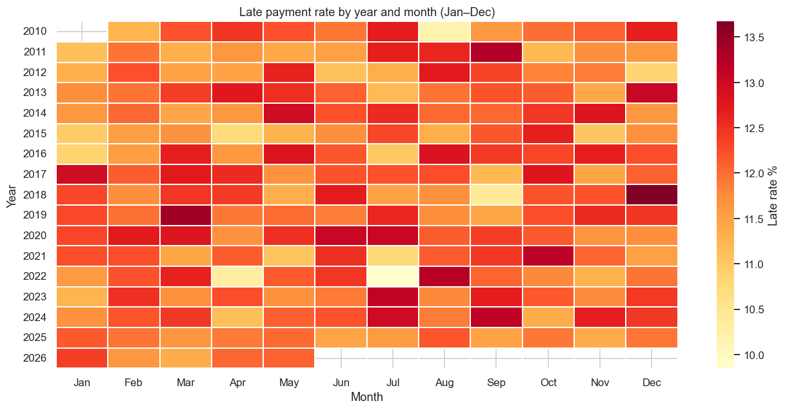

**Insight (simple terms):** This scans many years at once. Darker cells mean a higher late payment rate for that month/year. Look for repeating month patterns (seasonality) or years that stand out.

### 6) Pairwise year comparisons (Jan–Dec, from 2010 onward)
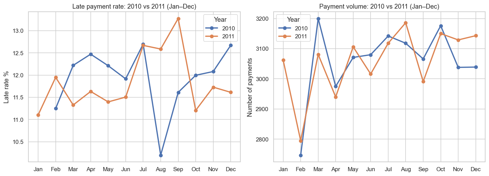

**Insight (simple terms):** Each pair compares two years month-by-month for **late payment rate** and **payment volume** (saved as `reports/figures/compare_{year1}_vs_{year2}.png`, e.g., 2010 vs 2011, 2012 vs 2013, …). Compare the same month across years, use volume for context, and treat missing/low-volume months cautiously.

### 7) February payment-volume investigation
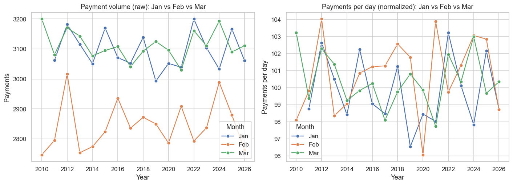

**Insight (simple terms):** February can look lower because it has **fewer days** (28/29). **Payments per day** is the key test: if Feb’s per-day rate is close to Jan/Mar, the drop is mostly calendar/structural (and day 29–31 effects matter). If per-day is still much lower, investigate timing/processing/coverage factors.

### 8) Payment regularity & lateness severity (loan-level)
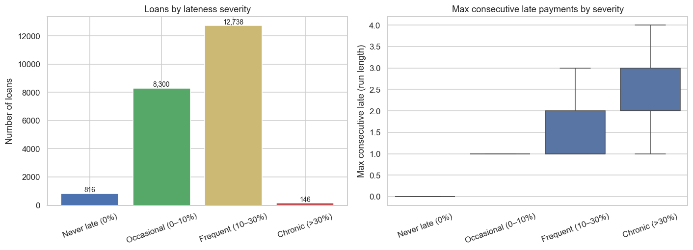

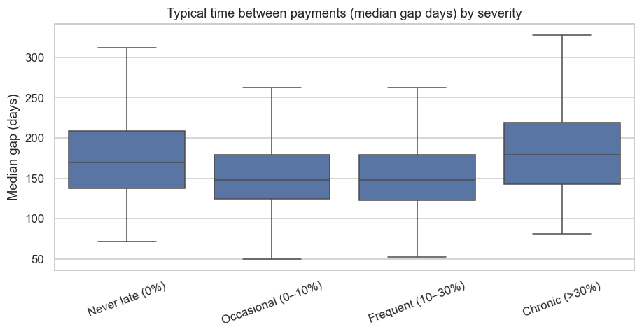

**Insight (simple terms):** Severity buckets show how many loans are never late vs occasionally/frequently/chronic (by % of payments late). **Max consecutive late runs** and **payment timing gaps** help distinguish occasional slips from repeated/in-a-row lateness. These patterns guide review; they don’t prove causes.

### 9) Drivers of late payments (segment + controls)
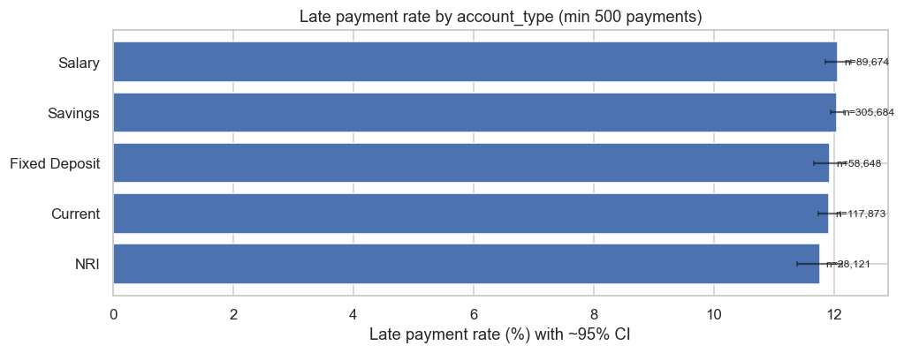

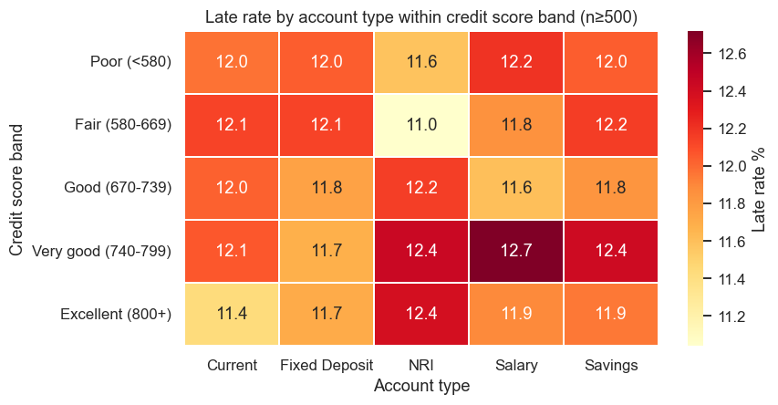

**Insight (simple terms):** Segment charts compare late rates with **minimum sample sizes** and **~95% confidence intervals** (using capped bands where appropriate). Differences suggest associations, not causes. The credit-score-band control view helps compare account types within similar credit bands.

## Setup

From the project folder in PowerShell:

```powershell
py -3 -m venv .venv
.\.venv\Scripts\Activate.ps1
python -m pip install -r requirements.txt
```

Open the notebooks in VS Code or Jupyter and run cells from top to bottom:
- `notebooks/inventory_overview.ipynb` (metadata-only inventory)
- `notebooks/01_inventory.ipynb` (quality checks + verified relationships)
- `notebooks/02_loan_repayment.ipynb` (loan repayment analysis; also generates figures in `reports/figures/`)

## Notes
- The dataset contains sensitive information; keep raw/processed data and revealing outputs out of Git.
- Processed reuse files (e.g., `loans_full.csv`, `loan_level.csv`) can be saved to `data/processed/` locally from `02_loan_repayment.ipynb`.
